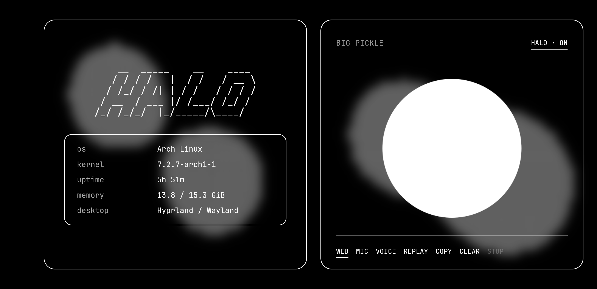

# Halo

Voice assistant on your Android phone, brain and hands on your Linux laptop.



Say "Halo", speak, and the laptop transcribes it, asks Gemini (through [OpenCode](https://opencode.ai)), runs any commands on the laptop, and speaks the answer back on the phone. Speech recognition, wake word and voice all run locally.

## Install

**Laptop** (Linux, systemd):

```bash
git clone https://github.com/dsksnkz/halo && cd halo
./install.sh
```

Needs `python3`, `opencode` (logged in to Google: `opencode auth login`), `playerctl`, `cava`, `fastfetch`, `adb`.
Then merge `server/opencode-halo.json` into `~/.config/opencode/opencode.jsonc`.

**Phone**: install `Halo.apk` from [Releases](../../releases), connect it by USB with debugging on, and pair:

```bash
.venv/bin/python android/pair-phone.py
```

Tap **Pair** on the phone. After that it connects over Wi-Fi (TLS, pinned to your laptop's certificate).
Allow TCP 8767 and UDP 8768 on your LAN if you use a firewall.

Optional tray app: `python3 companion/install.py` (PySide6).

## Notes

- GPU speech recognition: set `HALO_CUDA_LIBS` to a folder with CUDA 12 cuBLAS; otherwise it uses the CPU.
- Commands needing permission show Allow once / Deny on the phone.
- Build the APK yourself: `HALO_ANDROID_SDK=/path/to/sdk android/build.sh` (JDK 17).
